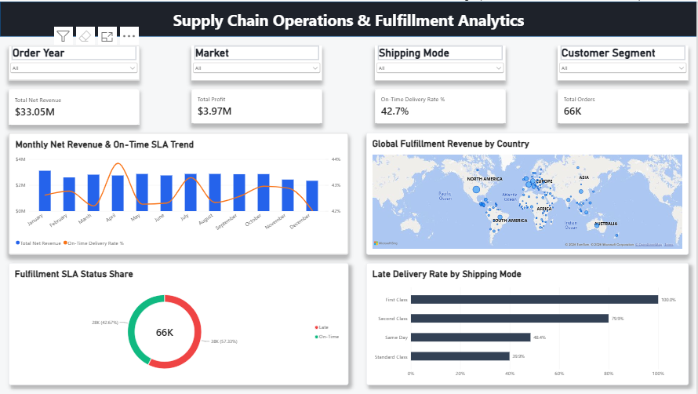

# Supply Chain Fulfillment Analytics

An end-to-end data engineering and business intelligence solution built using SQL Server (Medallion Architecture) and Power BI. This platform processes e-commerce order data, automates data transformations across staging layers, constructs an analytical data model, and delivers interactive executive dashboards for inventory fulfillment and supply chain performance.

---

## 📊 Executive Dashboard Preview

---

## 🏗️ Architecture & Pipeline Overview

The project implements the Medallion (Bronze -> Silver -> Gold) Architecture inside SQL Server to ensure raw data ingestion, structural cleansing, and dimensional modeling:

[ Raw Dataset / Staged CSV ]
            │
            ▼
┌───────────────────────┐
│     BRONZE LAYER      │  --> Raw data ingestion & staging schemas
└───────────┬───────────┘
            │  (T-SQL ETL Stored Procedures / Cleansing)
            ▼
┌───────────────────────┐
│     SILVER LAYER      │  --> Data-typed, deduplicated, & normalized tables
└───────────┬───────────┘
            │  (Gold Analytical Views & Star Schema)
            ▼
┌───────────────────────┐
│      GOLD LAYER       │  --> Business views, aggregated metrics, & star schema
└───────────┬───────────┘
            │  (Power BI Import / Connection)
            ▼
┌───────────────────────┐
│   POWER BI DASHBOARD  │  --> Executive KPI tracking, DAX metrics, & visual analytics
└───────────────────────┘

---

## 🛠️ Tech Stack

- Data Ingestion: Python (Pandas, SQLAlchemy, PyODBC)
- Database & ETL Engine: Microsoft SQL Server, T-SQL (DDL/DML, Stored Procedures, Views, Star Schema)
- Business Intelligence: Power BI Desktop (DAX Measures, Data Modeling, Custom Visuals)
- Version Control: Git, GitHub

---

## 📁 Repository Structure

supply-chain-fulfillment-analytics/
├── .gitignore
├── LICENSE
├── README.md
├── Python/
│   └── 01_data_ingestion_to_bronze.ipynb  # Python ingestion notebook for Bronze staging
├── sql/
│   ├── 01_bronze_ingestion.sql        # Table definitions & raw data staging
│   ├── 02_silver_transformations.sql   # Data cleaning, null handling, & schema normalization
│   └── 03_gold_analytical_views.sql   # Star schema views & aggregated business metrics
└── powerbi/
    ├── dashboard_preview.png          # High-resolution dashboard screenshot
    └── supply_chain_dashboard.pbix    # Power BI report file with interactive visualizations

---

## 📊 Business Key Performance Indicators (KPIs)

- Order Fulfillment Rates: Analyzes order-to-shipment lead times and identifies delivery delay bottlenecks across regions.
- Inventory Turnover & Stockouts: Evaluates stock movement trends, safety stock thresholds, and stockout frequency across product categories.
- Fulfillment Metrics (DAX): Custom DAX calculations measuring On-Time In-Full (OTIF) fulfillment rates, MoM performance trends, and average order cycle times.

---

## 🚀 How to Replicate

1. Clone the Repository:
   git clone https://github.com/alexngei333-analyst/supply-chain-fulfillment-analytics.git
   cd supply-chain-fulfillment-analytics

2. Ingest & Transform Data:
   * Execute `Python/01_data_ingestion_to_bronze.ipynb` to load raw CSV datasets into SQL Server Bronze tables.
   * Open SQL Server Management Studio (SSMS) and execute `sql/02_silver_transformations.sql` to clean raw data.
   * Execute `sql/03_gold_analytical_views.sql` to build Gold analytical views.

3. Open Power BI Report:
   * Launch Power BI Desktop and open `powerbi/supply_chain_dashboard.pbix`.
   * Update the database server name in **Transform Data > Data Source Settings** to point to your local SQL Server instance (`ALEXANDER\SQLEXPRESS`).

---

## 📜 License

This project is licensed under the MIT License.
